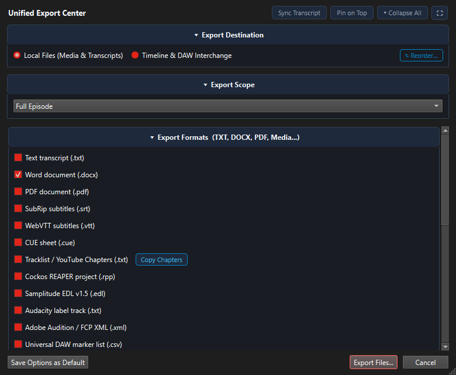

# Export Formats & DAW Integration Guide

Radio & TV Segmenter provides a versatile Unified Export Center (`Ctrl+E` or `File > Export...`) supporting broadcast audio cuts, document reports, digital audio workstation (DAW) timelines, and video editing interchange formats.

---

## 1. Export Destinations Overview

At the top of the Unified Export Center, choose between 4 primary export destinations:
1. **Local Files (Media & Transcript)**: Split audio cuts, Word/PDF cue sheets, subtitles, and chapter tracklists saved directly to disk.
2. **WordPress Draft Post**: Multi-story draft posts with Gutenberg audio players, taxonomy, and responsive YouTube video embeds.
3. **Timeline & DAW Interchange**: Non-destructive multi-track project sequences for digital audio workstations and NLEs.
4. **YouTube Video Publisher**: Video upload to YouTube with metadata and automated description chapters.

---

## 2. Split Audio Cuts with Real-Time Fades

Under **Local Files (Media & Transcript)**, export each detected story as an independent audio file for broadcast syndication, podcasting, or archiving:
- **Formats**: MP3 (configurable bitrate), WAV (lossless 16/24-bit), FLAC, M4A, OGG.
- **Audio Fades**: Automatically renders user-defined fade-in and fade-out volume curves into each cut.
- **ID3 Metadata**: Automatically embeds episode title, artist, year, track numbers, and cover art into exported MP3 and FLAC files.
- **Naming Patterns**: Automatically names files based on story titles, episode numbers, and dates (e.g. `2026-11-04_Story01_EnergyGrid.mp3`).

---

## 3. Document & Report Exports

Share transcripts and show rundowns with editorial staff and producers:
- **Microsoft Word (.docx)**: Styled documents with headings, timestamps, speaker headers, and story excerpt blocks.
- **Adobe PDF (.pdf)**: High-resolution broadcast cue sheets with exact timecode alignment and speaker tags.
- **Plain Text (.txt) & Markdown (.md)**: Clean text files ideal for note-taking apps, summaries, and web publishing.
- **Tracklist / YouTube Chapters (.txt)**: Formatted timestamped chapter lists ready for YouTube video descriptions (also accessible instantly via **Ctrl+Shift+Y**).
- **Red Book Cue Sheet (.cue)**: Playout automation index files.
- **Google Docs & Sheets**: Directly creates formatted Google Docs articles and Google Sheets rundown schedules via Google Drive integration.

---

## 4. Broadcast DAW & Video Editor Timelines

Select **Timeline & DAW Interchange** or use RTVS3's live clipboard bridges to assemble and edit in professional audio workstations and NLEs:

### Real-Time REAPER & DAW Live Bridge (Recommended)
Rather than manually exporting files, you can copy selections directly from RTVS3 into your DAW:
- **Cockos REAPER Live Companion Bridge**:
  - Press standard **Ctrl+C** on any transcript or timeline selection in RTVS3.
  - In REAPER, trigger `Script: rtvs_reaper_companion.lua` (assignable to a shortcut) to paste the clip immediately at the edit cursor.
  - Features zero-generation sample-accurate referencing of the master media, verbatim transcripts in **Item Notes (`P_NOTES`)**, speaker color coding, non-destructive fades, customizable take markers, and dynamic transcript auto-sync when clips are trimmed or split on the REAPER timeline.
  - Includes an optional dockable ReaImGui browser (`rtvs_reaper_dock.lua`) for searching and inserting quotes live from within REAPER.
  - See the dedicated **[REAPER & DAW Live Bridge Guide](reaper_and_daw_integration.md)** for full step-by-step setup instructions.
- **Universal Audio Clipboard for Other DAWs (Audition, Premiere, DaVinci Resolve)**:
  - Enable **Render temporary WAV audio clip to OS file clipboard** in **Settings > Preferences... > Playback & Timeline**.
  - When copying in RTVS3, a lossless uncompressed WAV slice is attached to the OS file clipboard (`CF_HDROP`), allowing direct **Ctrl+V** pasting onto timeline tracks in Adobe Audition, Premiere Pro, DaVinci Resolve, and Pro Tools.

### Timeline File Exports:
- **Cockos REAPER Project (.rpp)**:
  - Generates full REAPER project files with each story arranged on separate tracks or color-coded regions with take markers.
  - Automatically translates audio volume fades into native REAPER fade handles.
- **Final Cut Pro XML & Adobe Premiere Pro**:
  - Exports timeline sequences with markers, split clips, and synchronized audio channels.
- **CMX 3600 EDL (Edit Decision List)**:
  - Industry-standard interchange format compatible with Avid Media Composer, DaVinci Resolve, and broadcast playout automation.
- **Magix Samplitude EDL (v1.5)**:
  - Multi-track timeline cues compatible with Samplitude and Sequoia broadcast workstations.
- **Subtitles & Captions (.srt, .vtt)**:
  - Generates synchronized SubRip (`.srt`) and WebVTT (`.vtt`) caption files with speaker labels for YouTube, Vimeo, and video players.
