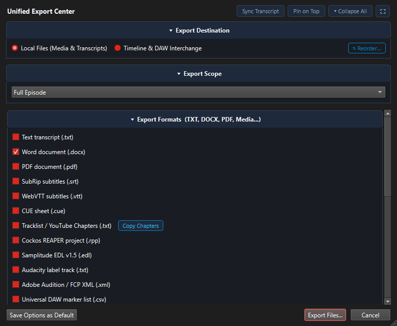

# Export Formats & DAW Integration Guide

Radio & TV Segmenter provides a versatile Unified Export Center (`Ctrl+E` or `File > Export...`) supporting broadcast audio cuts, document reports, digital audio workstation (DAW) timelines, and video editing interchange formats.

---

## 1. Export Destinations Overview

At the top of the Unified Export Center, choose between the available export destinations:
1. **Local Files (Media & Transcripts)**: Split audio cuts, Word/PDF cue sheets, subtitles, and chapter tracklists saved directly to disk.
2. **WordPress Draft Post**: Multi-segment draft posts with Gutenberg audio players, taxonomy/authors, and responsive YouTube video embeds.
3. **Timeline & DAW Interchange**: Non-destructive multi-track project sequences for digital audio workstations and NLEs.
4. **YouTube Video Publisher**: Zero-Auth assisted YouTube export packages (MP4, thumbnail, captions, and clipboard chapters for YouTube Studio).

### Export Scope & Custom Selection
Use the **Export Scope** dropdown to export **Custom Selection**, **All Segments**, **Full Episode**, or **Full Episode & All Segments**. Choosing **Custom Selection** displays the checkable **Items to Export:** sidebar on the left (**Full Episode** plus every segment, with **Select All** and **Clear** buttons) so you can mix and match the Full Episode and any subset of segments across all four destinations.

---

## 2. Split Audio Cuts with Real-Time Fades

Under **Local Files (Media & Transcripts)**, export each detected segment as an independent audio file for broadcast syndication, podcasting, or archiving:
- **Formats**: MP3 (configurable bitrate), WAV (lossless 16/24-bit), FLAC, M4A, OGG.
- **Loudness & Audio Fades**: Automatically renders user-defined fade-in and fade-out volume curves (*Linear*, *S-Curve*, *Logarithmic*, or *Exponential*—configurable as defaults under **Settings > Preferences... > Playback & Timeline**) into each cut, and pairs with **Tools > Normalize Audio Loudness...** (**Ctrl+Alt+N**) or automatic EBU R128 boost in **Preferences > Audio Settings**.
- **ID3 Metadata**: Automatically embeds episode title, artist, year, track numbers, and cover art into exported MP3 and FLAC files (also editable standalone via **Ctrl+Shift+I**).
- **Naming Patterns**: Automatically names files based on segment titles, episode numbers, and dates (e.g. `2026-11-04_Segment01_EnergyGrid.mp3`).

---

## 3. Document & Report Exports

Share transcripts and show rundowns with editorial staff and producers:
- **Microsoft Word (.docx)**: Styled documents with headings, timestamps, speaker headers, and segment excerpt blocks.
- **Adobe PDF (.pdf)**: High-resolution broadcast cue sheets with exact timecode alignment and speaker tags.
- **Plain Text (.txt)**: Clean transcripts with optional speaker headers, timestamps, and editorial notes.
- **Tracklist / YouTube Chapters (.txt)**: Formatted timestamped chapter lists ready for YouTube video descriptions (also accessible instantly via **Ctrl+Shift+Y**).
- **Subtitles & Captions (.srt, .vtt)**: Synchronized SubRip and WebVTT caption files with speaker labels for YouTube, Vimeo, and video players.
- **Red Book Cue Sheet (.cue)**: Playout automation index files (available under Timeline & DAW Interchange).

---

## 4. Broadcast DAW & Video Editor Timelines

Select **Timeline & DAW Interchange** or use RTVS3's live clipboard bridges to assemble and edit in professional audio workstations and NLEs:

### Real-Time REAPER & DAW Live Bridge (Recommended)
Rather than manually exporting files, you can copy selections directly from RTVS3 into your DAW:
- **Cockos REAPER Live Companion Bridge**:
  - Press standard **Ctrl+C** on any transcript or timeline selection in RTVS3.
  - In REAPER, trigger `Script: rtvs_reaper_companion.lua` (assignable to a shortcut) to paste the clip immediately at the edit cursor.
  - Features zero-generation sample-accurate referencing of the master media, verbatim transcripts in **Item Notes (`P_NOTES`)**, speaker color coding, non-destructive fades, customizable take markers, and dynamic transcript auto-sync when clips are trimmed or split on the REAPER timeline.
  - Includes an optional dockable ReaImGui browser (`rtvs_reaper_dock.lua`) for searching and inserting quotes live from within REAPER.
  - See the dedicated **[REAPER & DAW Live Bridge Guide](reaper_and_daw_integration.md)** for full step-by-step setup instructions.
- **Universal Audio Clipboard for Other DAWs (Audition, Premiere, DaVinci Resolve)**:
  - Enable **Enable WAV audio clip rendering (Ctrl+Shift+C) for non-REAPER DAWs** under **Settings > Preferences... > External Audio & Video Editors**.
  - Press **Ctrl+Shift+C** (or right-click and choose **Copy as Audio Clip**) to attach a lossless uncompressed WAV slice to the OS file clipboard (`CF_HDROP` / `text/uri-list`), allowing direct **Ctrl+V** pasting into Adobe Audition, Premiere Pro, DaVinci Resolve, and Pro Tools.

### Timeline File Exports:
- **Cockos REAPER Project (.rpp)**:
  - Generates full REAPER project files with each segment arranged on tracks or color-coded regions with take markers and native REAPER fade handles.
- **Final Cut Pro 7 XML (.xml) & Final Cut Pro X (.fcpxml)**:
  - Exports timeline sequences compatible with Final Cut Pro and Adobe Premiere Pro with markers, split clips, and synchronized audio channels.
- **Universal AAF (.aaf)**:
  - Broadcast NLE/DAW interchange compatible with Avid Media Composer, Pro Tools, and DaVinci Resolve.
- **Magix Samplitude EDL (.edl v1.5) & Hindenburg (.nhx)**:
  - Multi-track timeline and broadcast audio journalism interchange formats.
- **Audacity Labels (.txt), Red Book CUE (.cue) & Timecode CSV (.csv)**:
  - Region labels, CD/playout track cues, and spreadsheet/automation tables with optional **SubRip (.srt)** / **WebVTT (.vtt)** subtitle files.
