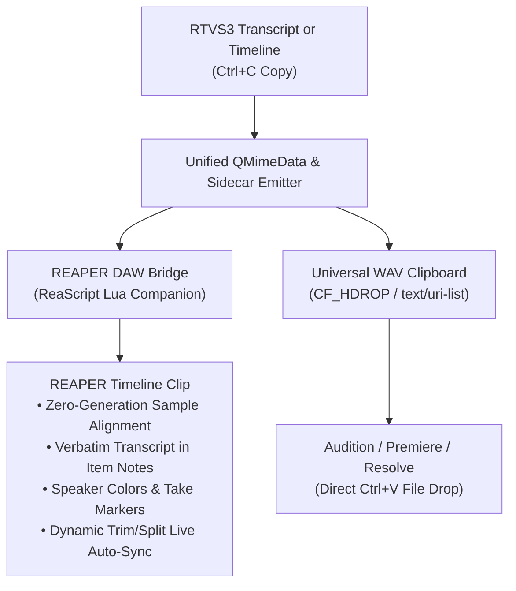

# REAPER & Digital Audio Workstation (DAW) Live Bridge

This guide explains how to configure and use the real-time copy/paste integration between **Radio & TV Segmenter (RTVS3)** and **Cockos REAPER DAW** (as well as other DAWs and video editors such as Adobe Audition, Premiere Pro, and DaVinci Resolve).

---

## 1. Architectural Overview

Radio & TV Segmenter and digital audio workstations serve complementary roles in modern broadcast and podcast production:
- **RTVS3**: Speech intelligence, automated transcription, speaker diarization, story boundary detection, and rapid quote logging.
- **REAPER / DAWs**: Multi-track assembly, fine audio leveling, noise reduction, music ducking, equalization, and final broadcast mastering.

Rather than forcing users to export files and manually re-import them, RTVS3 provides a **unified multi-channel clipboard and real-time IPC bridge**:



### Key Advantages of the Live Bridge:
1. **Zero Generation Loss & Non-Destructive Referencing**: Pasting a clip into REAPER references the original master audio file using native REAPER timeline offsets (`D_STARTOFFS` and `D_LENGTH`), without re-encoding or introducing lossy artifacts.
2. **Verbatim Transcript in Item Notes**: Full speaker-attributed dialogue is automatically injected into REAPER's native **Item Notes (`P_NOTES`)**, keeping the spoken transcript permanently attached to the audio block wherever it is moved on the timeline.
3. **Take Markers**: Visual markers placed directly on the media take indicate speaker turns or concise sentence cues.
4. **Dynamic Trim, Extend & Split Auto-Sync**: If you drag the edges of an inserted clip in REAPER to expand or trim context, or split a clip into multiple pieces with `S`, the transcript in Item Notes, the Take Name timecode range, and Take Markers automatically update to match the new boundaries.
5. **Universal Audio Clipboard Fallback**: For other audio and video editors (Audition, DaVinci Resolve, Premiere), RTVS3 can automatically render temporary lossless WAV slices to the OS clipboard on `Ctrl+C`.

---

## 2. Setting Up the REAPER Companion Scripts

RTVS3 bundles four native ReaScript Lua scripts:
- **`rtvs_reaper_companion.lua`**: Fast one-key action to paste the latest copied RTVS3 selection at the REAPER edit cursor.
- **`rtvs_reaper_auto_sync.lua`**: Continuous background watcher that monitors the timeline and automatically updates Item Notes, Take Names, and Take Markers whenever you drag clip edges or split items (`S`).
- **`rtvs_reaper_sync.lua`**: Manual one-shot action to immediately scan and refresh all trimmed/split clips on the timeline.
- **`rtvs_reaper_dock.lua`**: Optional dockable ReaImGui browser panel inside REAPER to search, browse, and insert stories or segments with live polling.

### Step 1: Install Scripts from RTVS3 Preferences
1. In RTVS3, go to **Settings > Preferences...** (or press **Ctrl+,**).
2. Click the **External Audio & Video Editors** tab on the left sidebar.
3. Review the **REAPER DAW Companion Bridge** settings.
4. Click **Install REAPER Companion Scripts...**.
5. RTVS3 automatically detects your REAPER resource directory:
   - **Windows**: `%APPDATA%\REAPER\Scripts\RTVS3`
   - **macOS**: `~/Library/Application Support/REAPER/Scripts/RTVS3`
   - **Linux**: `~/.config/REAPER/Scripts/RTVS3`
   *(If using a portable REAPER installation, you can browse to select its directory).*
6. Click **Install Scripts**. The installer copies `rtvs_reaper_companion.lua` and `rtvs_reaper_dock.lua` into your REAPER scripts folder.

### Step 2: Register the Script in REAPER's Action List
1. Open **Cockos REAPER**.
2. Press `?` (or go to **Actions > Show action list...**).
3. In the bottom-right corner, click **New action... > Load ReaScript...**.
4. Browse to your `Scripts/RTVS3` directory and select all scripts:
   - `rtvs_reaper_companion.lua`
   - `rtvs_reaper_auto_sync.lua`
   - `rtvs_reaper_sync.lua`
   - `rtvs_reaper_dock.lua`
5. Click **Open**. Both scripts are now registered in REAPER's action list.

### Step 3: Assign a Keyboard Shortcut in REAPER (Recommended)
1. In REAPER's Action List, search for `RTVS3` in the filter box.
2. Select **`Script: rtvs_reaper_companion.lua`**.
3. In the bottom-left **Shortcuts for selected action** section, click **Add...**.
4. Press your desired shortcut key (for example: **Ctrl+V**, **Alt+V**, or **Ctrl+Shift+V**).
5. Click **OK** and close the Action List.

---

## 3. How to Copy from RTVS3 & Paste into REAPER

### Copying in RTVS3:
You can copy audio selections using either the **Transcript** or **Timeline** view:
- **From the Transcript**:
  - Drag to highlight any passage of spoken dialogue.
  - Or click any story header tag in the transcript.
  - Press standard **Ctrl+C** (or right-click and choose **Copy (Ctrl+C)**).
- **From the Timeline**:
  - Right-click and drag across the waveform to create a drag selection range.
  - Or click any existing story block on the timeline.
  - Press standard **Ctrl+C** (or right-click and choose **Copy Selection (Ctrl+C)**).

> **Unified Multi-Channel Copy:** A single `Ctrl+C` copy action bundles plain text, formatted HTML, REAPER IPC JSON metadata, and optional WAV clip files simultaneously.

### Pasting into REAPER:
1. Switch to REAPER.
2. Click on the timeline track where you want the clip placed and position your edit cursor.
   *(If no track is selected, the companion script automatically creates or routes to a track named `"RTVS3 Assemble"`).*
3. Press your assigned shortcut for `rtvs_reaper_companion.lua` (e.g. `Alt+V`).
4. The media item immediately appears on the timeline:
   - Aligned precisely to the sample range copied from RTVS3.
   - Color-coded with the speaker's assigned color.
   - Non-destructive volume fade handles applied if configured in RTVS3.
   - The edit cursor advances automatically to the end of the newly placed clip, ready for immediate sequential assembly.

---

## 4. Where is the Transcript? (Item Notes & Take Names)

### Item Notes (`P_NOTES`):
The full verbatim transcript is stored inside REAPER's native **Media Item Notes** formatted with line and paragraph breaks identical to the RTVS3 transcript view:

```text
[00:10.0] Mayor Bradley:
Mayor announced the new budget transit proposal today.

[00:40.0] Council Member:
The funding expands light rail operations across the county.
```

- **How to view in REAPER**:
  - Right-click the media item on the timeline and choose **Item notes** (or press the Item Notes shortcut in REAPER).
  - Or click the small note icon in the upper-left of the media item header bar.
- The notes window opens, displaying the cleanly formatted, paragraph-separated transcript for that clip.

### Take Name (`P_NAME`):
The Take Name is formatted with the story title or the first 45 characters of spoken dialogue, followed by the exact timecode range:
```text
Mayor Bradley: Transit funding announcement [00:10.0 - 01:10.0]
```

---

## 5. Speaker Color Coding & Take Marker Styles

### Automatic Speaker Color Coding:
By default, pasted clips and take markers are automatically color-coded with the primary speaker's assigned color from RTVS3. If you prefer to manage track, item, and marker colors manually in REAPER:
- Go to **Settings > Preferences... > External Audio & Video Editors**.
- Uncheck **Apply speaker color coding to pasted DAW clips**.
- When disabled, ALL color coding rules are bypassed: the media item, take, and all take markers retain default REAPER track and theme coloring.

### Customizing Take Marker Styles:

Take markers appear directly on media items in REAPER as visual landmarks. You can customize their density in RTVS3 under **Settings > Preferences... > External Audio & Video Editors > REAPER Take Marker Style**:

1. **Speaker Changes Only (Default & Recommended)**:
   - Places a single color-coded take marker at the beginning of each speaker turn (e.g., `[Mayor Bradley]`).
   - Keeps your timeline clean and uncluttered while clearly marking speaker hand-offs.
2. **Speaker Changes + True Sentence Cues**:
   - Places concise, 6-word phrase preview markers at true grammatical sentence breaks (terminated by periods, question marks, exclamation points, or speech pauses >= 1.5 seconds) and speaker turns.
   - Compatible with both Whisper and Parakeet ASR models, preventing mid-sentence segment fragments or minor breath pauses from cluttering the timeline with duplicate markers.
3. **None (No Take Markers)**:
   - Completely omits take markers from the media item.
   - Ideal for minimalist workflows; the full transcript remains accessible at any time inside the **Item Notes**.

---

## 6. Live Non-Destructive Trim, Extend & Split Auto-Sync

One of the most powerful capabilities of the RTVS3 REAPER bridge is **automatic transcript re-slicing**:

### What Happens When You Trim or Extend in REAPER:
Because the media item references your master episode file rather than an isolated rendered file:
1. Drag the **left edge** of the item earlier in time to pull in earlier context or intro dialogue.
2. Drag the **right edge** of the item later in time to extend the sentence or capture the reaction.
3. Split the item into two separate clips by positioning the edit cursor and pressing `S`.

### How Auto-Sync Works:
- Each item inserted by RTVS3 is tagged with extended metadata (`P_EXT:RTVS3_MANAGED`).
- Whenever the start offset (`D_STARTOFFS`) or item length (`D_LENGTH`) changes:
  - The script slices the master transcript index (`latest_transcript_index.json`) for the new timecode range.
  - The **Item Notes (`P_NOTES`)** are automatically updated with the newly expanded or trimmed dialogue.
  - The timecode range in the **Take Name** is updated.
  - The Take Markers are automatically cleared and repositioned for the new boundaries.
### How to Run Auto-Sync:
Because REAPER only executes ReaScripts when triggered or while a background loop is running, RTVS3 provides seamless auto-sync options:
1. **Automatic Background Activation via Paste (`rtvs_reaper_companion.lua`)**:
   - When you run `rtvs_reaper_companion.lua` to paste a clip, it **automatically launches a background watcher loop** in REAPER.
   - Any time you drag the edges of an RTVS3 clip to shrink or expand it, or split a clip with `S`, the Item Notes and Take Markers update automatically in real time (~0.35s)! You do not need to launch any separate script.
2. **Dedicated Background Toggle Action (`rtvs_reaper_auto_sync.lua`)**:
   - In REAPER, run **`Script: rtvs_reaper_auto_sync.lua`** (or add it to a toolbar button).
   - Its toolbar button lights up indicating it is active in the background. Click again to stop.
3. **One-Shot Manual Sync (`rtvs_reaper_sync.lua`)**:
   - Assign a shortcut (such as `F5` or `Alt+S`) to **`Script: rtvs_reaper_sync.lua`**.
   - Press it anytime after trimming or splitting to refresh all timeline clips immediately.
4. **ReaImGui Dock (`rtvs_reaper_dock.lua`)**:
   - Automatically checks and syncs clips every 0.5 seconds whenever the dock window is open, or click the **Sync Trimmed Clips** button in the dock header bar.

---

## 7. Using the Dockable ReaImGui Transcript Browser (`rtvs_reaper_dock.lua`)

If you have the free **ReaImGui** extension installed in REAPER (available via ReaPack):

1. In REAPER, run **`Script: rtvs_reaper_dock.lua`**.
2. A floating panel appears that can be docked anywhere in your REAPER workspace (e.g., beside the Mixer or below the Track Control Panel).
3. **Features of the Dock**:
   - **Real-Time Story Browser**: Lists all stories defined in your active RTVS3 project with exact durations. Click **Insert** next to any story to place it directly at the REAPER edit cursor.
   - **Transcript Segment Search**: Type any word or phrase into the search box to filter speech segments across the entire episode. Click **Insert** next to any speech line to place that exact quote.
   - **Paste Copied Clip**: One-click button to paste the active clipboard cue.
   - **Sync Trimmed Clips**: Forces an immediate re-sync of all trimmed or split clips on the timeline with the current transcript index.

---

## 8. Universal Audio Clipboard for Other DAWs (Audition, Premiere, Resolve)

If you work in digital audio workstations or non-linear video editors other than REAPER:

1. **Standard `Ctrl+C` (Clean Text & REAPER IPC)**:
   - Standard `Ctrl+C` copies plain text, formatted HTML, and the lightweight REAPER JSON cue payload.
   - It **never** attaches file URLs to the OS clipboard, ensuring pasting into chat windows, browsers, Google Docs, and emails always pastes clean text without triggering unexpected file uploads.
2. **Dedicated `Ctrl+Shift+C` (Copy Selection as Audio Clip)**:
   - When you specifically want to copy an audio file to paste into an external NLE or DAW, press **Ctrl+Shift+C** (or right-click and choose **Copy as Audio Clip** / **Copy Story as Audio Clip**).
   - RTVS3 rapidly renders a lossless, 16-bit uncompressed WAV slice of the exact selection (with any configured story audio volume fades applied) to a temporary cache file.
   - It attaches this file to the operating system's native file clipboard (`CF_HDROP` / `text/uri-list`).
3. Switch to **Adobe Audition**, **Adobe Premiere Pro**, **DaVinci Resolve**, or **Pro Tools**, and press **Ctrl+V** on any audio track. The trimmed audio file is immediately pasted onto your timeline.

---

## 9. Troubleshooting & Common Questions

### Q: REAPER shows "No RTVS3 clip cue sidecar file found" when running the companion script.
- **Cause**: No text or story has been copied yet in RTVS3, or automatic sidecar emission is disabled.
- **Fix**: Open RTVS3, highlight dialogue or select a story, and press **Ctrl+C**. In RTVS3 **Preferences > External Audio & Video Editors**, ensure **Automatically emit REAPER DAW clip cues when copying transcript text or stories** is checked.

### Q: How do I view Item Notes in REAPER?
- Right-click any media item in REAPER and select **Item notes**. Alternatively, enable **Media item buttons: Notes** under REAPER's **Options > Preferences > Appearance > Media**.

### Q: Why does the dock say "ReaImGui extension is not installed"?
- `rtvs_reaper_dock.lua` requires the free ReaImGui extension. Open REAPER, go to **Extensions > ReaPack > Browse packages**, search for `ReaImGui`, right-click and install it, then restart REAPER.
- Note: The primary paste companion script (`rtvs_reaper_companion.lua`) requires **zero** external extensions and works on any standard REAPER installation out of the box.

### Q: Can I use both REAPER integration and the universal WAV clipboard simultaneously?
- Yes. Use **Ctrl+C** for REAPER (and standard text pasting), which uses the zero-generation sample-accurate IPC sidecar referencing your master episode file. When you specifically need a standalone WAV file clip for Audition, Premiere, or File Explorer, use **Ctrl+Shift+C**.
