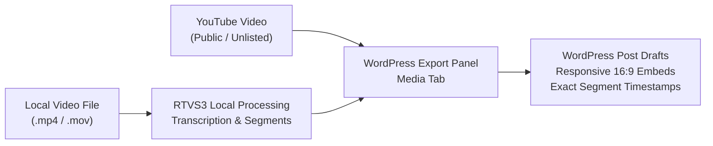
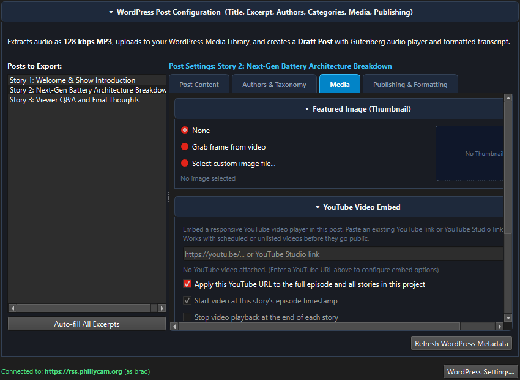
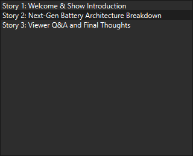

# Video Shows & YouTube Publishing Guide

This guide walks through the end-to-end workflow for transcribing, segmenting, and publishing video shows to WordPress with responsive, timestamp-synchronized YouTube video embeds.

---

## 1. Architectural Overview & The Hybrid Workflow

Publishing video shows to WordPress often involves a friction point: uploading full multi-gigabyte `.mp4` video files directly to WordPress web hosts can quickly exhaust server storage, exceed PHP upload limits, and result in sluggish mobile streaming.

Radio & TV Segmenter provides a streamlined **hybrid video workflow**:
1. **Local Media Processing**: You work directly with your original high-resolution video file (`.mp4`, `.mov`, `.mkv`, `.webm`) on your local machine for rapid transcription, speaker diarization, segment boundary detection, and timeline scrubbing.
2. **Video Hosting on YouTube**: You upload your full episode to YouTube (as unlisted, scheduled, or public).
3. **Automated Timestamped Embeds in WordPress**: By simply pasting your base YouTube link into the WordPress export dialog, the application automatically computes the start and end offsets for every segment and injects mobile-responsive, 16:9 Gutenberg iframe blocks (`<!-- wp:html -->`) directly into each segment's post draft.



---

## 2. Step-by-Step Workflow

### Step 1: Open Your Video Media (Local File or Existing YouTube URL)
- **Local Video**: Drag and drop your video file directly onto the timeline canvas or press **Ctrl+O** (**File > Open Media...**).
- **Existing YouTube Video (Back-Catalog Workflow)**: Go to **File > Open Remote Episode > From YouTube Video...** (**Ctrl+Alt+Y**), paste any YouTube URL, click **Fetch Info**, pick a resolution (default **1080p MP4** for sharp screenshots), and click **Download & Open**.
  - `yt-dlp` installs and updates automatically on demand into your app-data tools folder and uses RTVS3's bundled FFmpeg to merge streams into MP4.
  - For unlisted, scheduled, or bot-checked videos, expand **Advanced (Browser Cookies & yt-dlp)** to read cookies from Chrome, Edge, Firefox, or Brave.
  - If the video already has YouTube chapters, you can check **Import YouTube chapters as initial story markers** to pre-seed your segments.
  - Downloaded files are stored in the **Managed Remote Media Cache** (default 10 GB LRU cap, adjustable under **Tools > Manage Cached Remote Media...**); your YouTube URL and Video ID are automatically pre-bound for WordPress export (inherited across the Full Episode and all individual segments, with default Featured Images set to **YouTube default thumbnail** for the Full Episode and an in-bounds video frame for each segment).
- RTVS3 automatically generates multi-resolution waveform pyramids and a video thumbnail filmstrip along the timeline. Adjust **Thumbnail Density** (**Standard (2 per min)**, **Detailed (4 per min)**, **High (8 per min)**, or **Extra High (16 per min)**) in **Settings > Preferences... > Playback & Timeline**, or right-click anywhere on the timeline to choose **Regenerate Video Thumbnails** or **Regenerate Waveform**.
- Press **Ctrl+Shift+V** (**View > Timeline > Video Preview Window**) to open the resizable floating video preview window.

### Step 2: Transcribe, Diarize & Detect Segments
1. Click **Transcribe Audio...** (**Ctrl+T**) or use the Multi-Stage Pipeline (**Ctrl+R**) to generate word-level aligned transcripts and speaker turns.
2. Click **Detect Segments...** (**Ctrl+Shift+A**) to open the standalone detection confirmation dialog; click **Adjust Settings...** if you want a one-time override of silence gap, minimum segment length, detection basis, or padding (or check **Save these values as my new defaults**).
3. Review segments on the timeline: you can zoom in up to 300x, drag boundaries, and adjust audio fades.

### Step 3: Open Unified Export to WordPress
Press **Ctrl+E** (**File > Export...**) and select the **WordPress Draft Post** radio button from the **Export Destination** bar at the top. Choose **Export Scope > Custom Selection** if you want to check **Full Episode** and/or any specific subset of segments from the **Items to Export:** sidebar.

### Step 4: Configure the "Media" Tab
Select a segment (or your full episode) from the left-hand **Posts to Export:** list (or **Items to Export:** sidebar under **Custom Selection**), then switch to the **Media** tab (Tab 3):



1. **Review Featured Image**:
   - On YouTube-imported projects, **Full Episode** defaults to **YouTube default thumbnail** (cached locally from YouTube) and individual **segments** default to **Grab frame from video** inside each segment's time range (auto-captured during export even if you don't open every segment's Media tab). You can switch any post to another video frame, a custom image file, or **None**.
2. **Enter or Verify YouTube Video Link**:
   Paste the base URL of your video show (auto-filled and inherited across all segments for YouTube-imported projects or whenever **Apply this YouTube URL to the full episode and all stories** is checked). RTVS3 supports all standard link formats (see [URL Compatibility](#3-youtube-url-compatibility-reference)). Controls automatically illuminate when a valid URL is provided.
3. **Stop Video at Story End**:
   - **Checked (Recommended)**: The YouTube player will pause playback when the segment concludes (`?end=XXX`), encouraging readers to continue through your article or explore other segments.
   - **Unchecked**: The video will start at the segment's beginning (`?start=XXX`) and continue playing the remainder of the episode.
4. **Embed Placement**:
   - **Top (Default)**: Inserts the video player above your transcript text, placing the video prominently beneath the post title.
   - **Bottom**: Places the video player below the segment transcript and excerpt.

### Step 5: Review Audio & Podcast Options
For video projects, **Include audio files in WordPress export** defaults to unchecked:
- Because the YouTube video already provides full synchronized audio, extracting and uploading redundant MP3 files is disabled by default to save server bandwidth.
- If you uncheck audio inclusion, **Apply audio fades** is automatically unchecked and bypassed.
- If you explicitly check audio inclusion on a video file, RTVS3 displays a brief confirmation dialog to ensure you intended to produce a hybrid video + audio podcast post.

### Step 6: Inspect Post Prefix Indicators & Tooltips
In the left-hand **Posts to Export:** list, each item displays compact prefix badges right after the segment label:



- **`[YT]`**: Indicates an active YouTube embed link is configured with timestamp offsets.
- **`[Pod]`**: Indicates the post is configured as an audio podcast episode with enclosure tags.
- **`[A]`**: Indicates an MP3 audio cut will be uploaded to the WordPress media library.
- **`[Img]`**: Indicates a featured image (YouTube default thumbnail, extracted video frame, or custom image file) will be attached.
- **Example**: `Story 1 [YT, Img]: Demonstrators push for more funding...`
- Drag the splitter between the post list and editor tabs to expand the sidebar as desired.
- Hover over any post in the list to view a multi-line tooltip detailing exact start/end timestamps, author IDs, category tags, and embed settings.

### Step 7: Export to WordPress
Click **Export to WordPress Drafts...**. RTVS3 authenticates via the WordPress REST API and creates draft posts for all selected segments.

---

## 3. YouTube URL Compatibility Reference

The YouTube URL parser in RTVS3 automatically normalizes video IDs and time offsets across all common YouTube URL formats:

| Link Format | Example Input | Recognized Video ID |
| :--- | :--- | :--- |
| **Standard Watch** | `https://www.youtube.com/watch?v=dQw4w9WgXcQ` | `dQw4w9WgXcQ` |
| **Short Link** | `https://youtu.be/dQw4w9WgXcQ` | `dQw4w9WgXcQ` |
| **Embed Link** | `https://www.youtube.com/embed/dQw4w9WgXcQ` | `dQw4w9WgXcQ` |
| **Live Stream** | `https://www.youtube.com/live/dQw4w9WgXcQ` | `dQw4w9WgXcQ` |
| **YouTube Short** | `https://www.youtube.com/shorts/dQw4w9WgXcQ` | `dQw4w9WgXcQ` |
| **Studio Edit** | `https://studio.youtube.com/video/dQw4w9WgXcQ/edit` | `dQw4w9WgXcQ` |
| **Link with Existing Time** | `https://youtu.be/dQw4w9WgXcQ?t=2m5s` | `dQw4w9WgXcQ` *(start offset computed)* |
| **Raw 11-Char ID** | `dQw4w9WgXcQ` | `dQw4w9WgXcQ` |

---

## 4. Responsive 16:9 Gutenberg Embed Structure

RTVS3 generates standards-compliant Gutenberg Custom HTML blocks (`<!-- wp:html -->`) using a fluid 16:9 container:

```html
<!-- wp:html -->
<div class="rtvs-youtube-embed" style="position:relative;padding-bottom:56.25%;height:0;overflow:hidden;max-width:100%;margin:1.5rem 0;">
  <iframe src="https://www.youtube.com/embed/dQw4w9WgXcQ?rel=0&amp;start=145&amp;end=450" style="position:absolute;top:0;left:0;width:100%;height:100%;border:0;" allowfullscreen="" allow="accelerometer; autoplay; clipboard-write; encrypted-media; gyroscope; picture-in-picture"></iframe>
</div>
<!-- /wp:html -->
```

### Why This Matters:
1. **Works with Unlisted & Scheduled Videos**: Standard WordPress `<!-- wp:core-embed/youtube -->` blocks trigger server-side HTTP oEmbed validation. When a video is unlisted or scheduled for future release, WordPress's server often fails the oEmbed lookup, reverting the player to a plain text link. The Custom HTML block bypasses oEmbed verification while rendering reliably on all browsers.
2. **Mobile Responsive Without Theme CSS**: The `padding-bottom: 56.25%` rule maintains a true 16:9 aspect ratio across smartphones, tablets, and desktop displays without requiring theme-specific CSS plugins.
3. **`rel=0` Safe Related Videos**: Setting `rel=0` ensures that when playback pauses or completes, YouTube only displays related videos from your own channel rather than competing content.

---

## 5. Troubleshooting & FAQs

### Q: Why did the video preview window show a black box on macOS?
In earlier versions, the video preview dialog was lazily created after the media file was already loaded. On macOS Qt 6 with AVFoundation, `AVPlayer` configured an audio-only pipeline if no video sink was attached before `setSource()`. In **v3.9.74-beta** and later, RTVS3 pre-initializes the floating video dialog and attaches `setVideoOutput()` at startup, ensuring macOS Cocoa properly maps the `AVPlayerLayer`.

### Q: Can I set default YouTube embed options so I don't have to configure them every time?
Yes. Go to **Settings > Preferences...** (or press **Ctrl+P** / **Cmd+P** on macOS), navigate to the **WordPress** tab, and configure your defaults under **YouTube Video Embed Defaults**:
- **Default Stop Video at Story End**
- **Default Embed Placement (Top vs. Bottom)**

These settings are also mirrored under **Settings > Preferences... > YouTube**.
