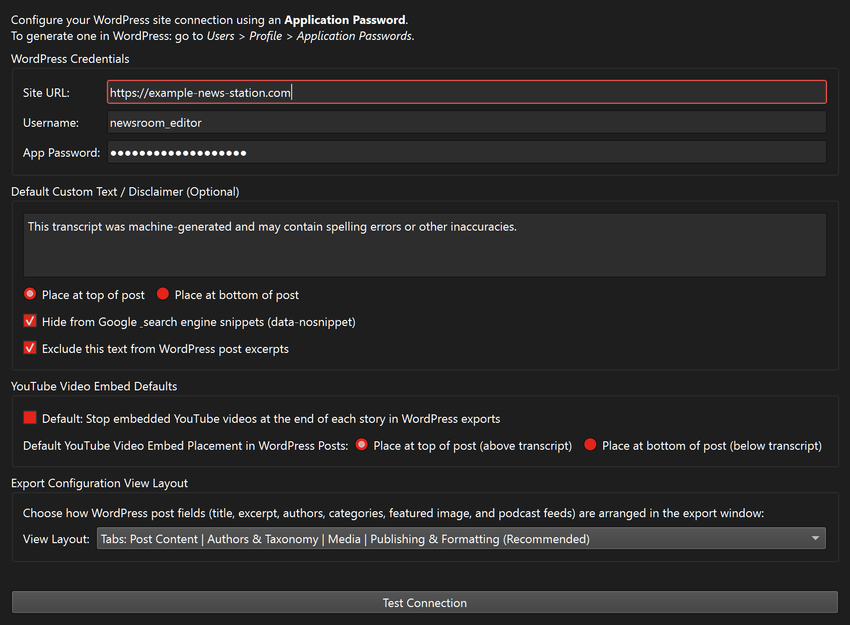
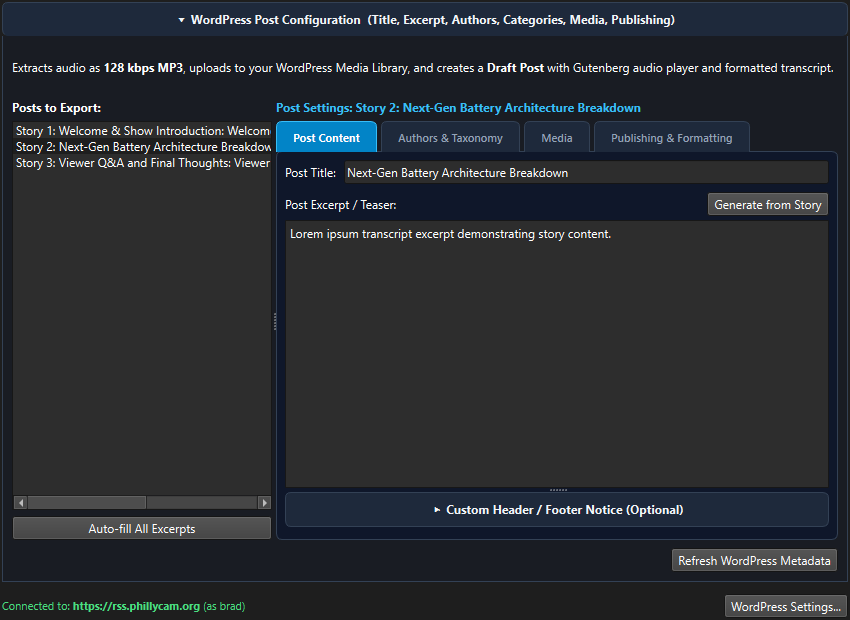
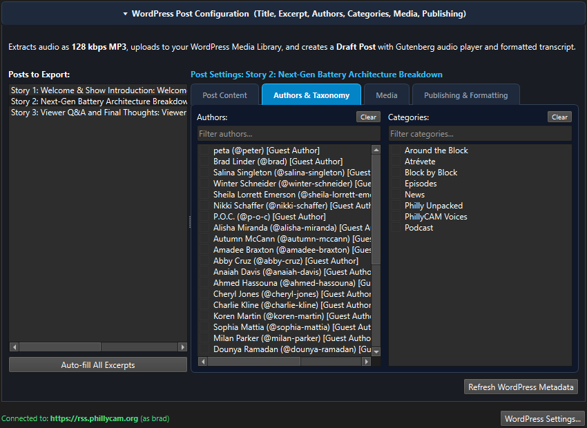
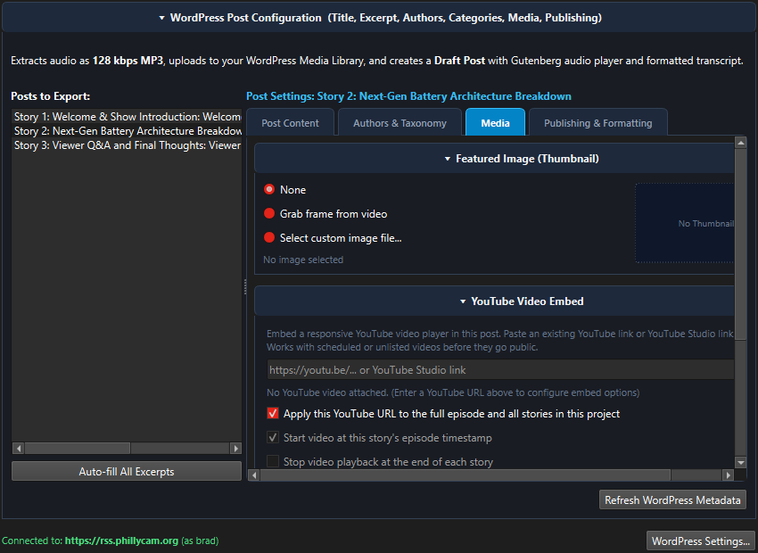
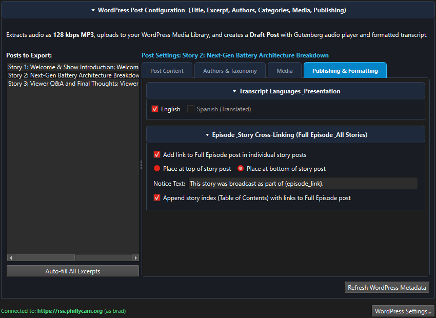
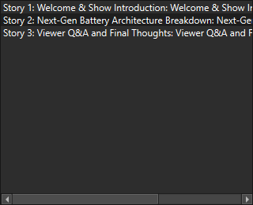

# WordPress Exporting & Setup Guide

This guide details how to configure RTVS3 to publish story drafts, podcast enclosures, and YouTube embeds directly to your WordPress website.

---

## 1. Creating a WordPress Application Password

To communicate securely with your WordPress site without sharing your master account password, RTVS3 uses standard **WordPress Application Passwords**.

### Step-by-Step in WordPress:
1. Log in to your WordPress admin dashboard (e.g., `https://yoursite.com/wp-admin`).
2. Navigate to **Users > Profile** (or click your name in the top right corner).
3. Scroll down to the **Application Passwords** section.
4. In the **New Application Password Name** field, type a label such as `RTVS3 Desktop` or `Story Segmenter`.
5. Click **Add New Application Password**.
6. WordPress will display a 24-character generated password formatted with spaces (e.g., `abcd efgh ijkl mnop qrst uvwx`).
7. **Copy this password immediately** (WordPress only displays it once).

> **Tip:** Application Passwords can be revoked at any time from your WordPress profile without changing your primary WordPress login password.

---

## 2. Entering Credentials in RTVS3

You can save your WordPress credentials in preferences so you only need to enter them once:

1. In RTVS3, go to **Settings > Preferences...** (or press **Ctrl+,**).
2. Click the **WordPress** tab on the left.

3. Fill in your details:
   - **Site URL**: The full web address of your WordPress homepage (e.g., `https://example-news-station.com`). Both `https://` and trailing slash variations are handled automatically.
   - **Username**: Your WordPress administrative or author username (e.g., `newsroom_editor`).
   - **App Password**: Paste the 24-character password generated in Step 1.
4. Click **Test Connection**. RTVS3 contacts your site's REST API. When successful, your site title and authenticated user permissions are confirmed.
5. Click **Save Preferences**.

---

## 3. Opening WordPress Export in the Unified Export Center

When your broadcast media has been segmented into stories, open the export panel:
1. Press **Ctrl+E** (or go to **File > Export...**).
2. In the **Export Destination** bar at the top, select the **WordPress Draft Post** radio button.

### Choosing Export Scope:
In the **Export Scope** dropdown, choose which posts you want to generate:
- **All Stories**: Generates separate draft posts for every detected story.
- **Selected Stories**: Generates drafts only for the stories currently highlighted in the Stories panel.
- **Full Broadcast**: Generates one post containing the complete episode transcript.
- **Full Broadcast and All Stories**: Generates one master episode post plus individual story posts.

---

## 4. Customizing Individual Post Details Across the 4 Tabs

Under **WordPress Post Configuration**, select any post in the left-hand **Posts to Export:** list. The divider between the post list and the editor pane is an expandable splitter that you can drag to widen the sidebar.

Configure each post across the 4 editor tabs:

### Tab 1: Post Content
- **Post Title**: The headline of the WordPress draft post.
- **Post Excerpt / Teaser**: A concise summary of the story used for article previews, RSS feeds, and social cards. Click **Generate from Story** to automatically extract a snippet (≤55 words) from the transcript.
- **Custom Notice / Disclaimer**: An optional notice (e.g., *"This story aired on Radio One on Nov 4"*) prepended or appended to the article.

### Tab 2: Authors & Taxonomy

- **Authors**: Search, filter, and select registered WordPress authors to assign bylines.
- **Categories**: Search, filter, and assign one or more WordPress categories (e.g., *News*, *Interviews*, *Local*).
- **Tags**: Enter comma-separated tag keywords.

### Tab 3: Media

- **Featured Image**: Choose a captured video thumbnail frame, custom image file, or disabled.
- **YouTube Video Link**: Paste a YouTube watch link, short link, or studio URL.
  - **Context-Aware Auto-Dimming**: Controls automatically dim when the URL field is empty and illuminate as soon as a valid video link is detected.
  - **Stop Video at Story End**: When checked, the embedded player automatically pauses playback when the segment concludes.
  - **Embed Placement**: Choose whether the responsive 16:9 player appears at the **Top** (above transcript) or **Bottom** (below transcript).
- **Include Audio Files**:
  - For radio and audio projects, checking this extracts a 128 kbps MP3 cut and uploads it to the WordPress Media Library.
  - For video shows, this defaults to unchecked because the YouTube embed already provides full audio.
  - **Apply Audio Fades**: Automatically rendered on the MP3 cut if audio inclusion is enabled.
- **Podcast Enclosure**: Check this to format the audio upload with Castos or standard RSS podcast enclosures so aggregator plugins detect the episode.

### Tab 4: Publishing & Formatting

- **Transcript Languages**: Select your primary spoken language and choose any translated languages to append to the post draft.
- **Episode Cross-Linking**: Automatically insert hyperlinks back to the full broadcast master post or related story segments.

---

## 5. Left-Hand Post List Prefix Indicators & Tooltips

In the **Posts to Export:** list, compact prefix tags appear immediately after the story number so you can verify each post's configuration at a glance, even when the sidebar is narrow:

- **`[YT]`**: A responsive YouTube embed with story timestamps is attached.
- **`[Pod]`**: Podcast RSS enclosure tags are configured.
- **`[A]`**: An MP3 audio cut will be uploaded.
- **`[Img]`**: A featured image or video thumbnail will be uploaded.
- **Example**: `Story 1 [YT, A]: Demonstrators push for more funding...`
- **Hover Tooltips**: Hover your mouse over any post in the list to view a multi-line tooltip detailing exact start/end timecodes, author names, and category tags.
- **Resizable Sidebar**: Drag the vertical splitter bar between the post list and the editor tabs to expand or shrink the sidebar.

---

## 6. Uploading Drafts to WordPress

Click **Export to WordPress Drafts...** at the bottom of the dialog:
- RTVS3 authenticates via the WordPress REST API and creates **Draft** posts on your WordPress site.
- Posts are created in draft status so you or your editorial team can review and preview them before publishing them live to the public.
- When upload completes, a clickable link takes you directly to the WordPress post editor.
